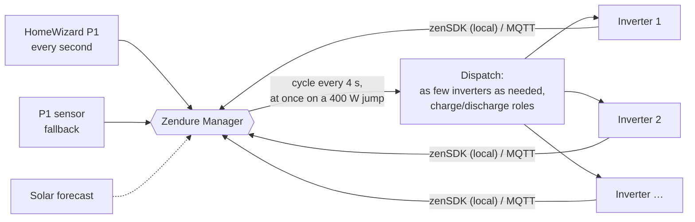
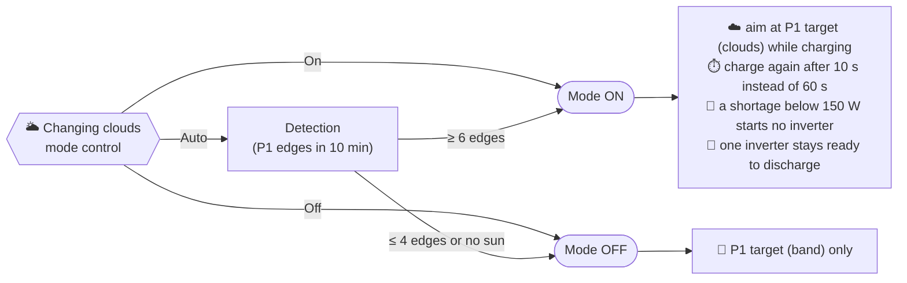
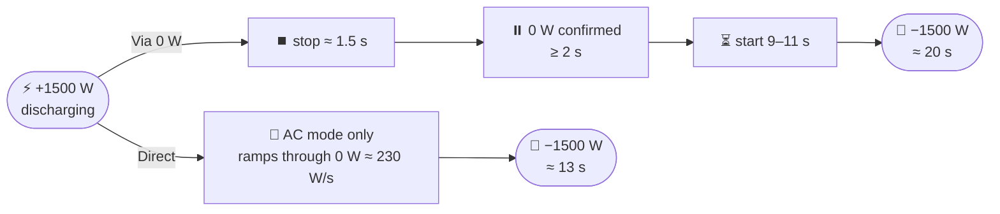

<h1 align="center">🔋 Zendure HA-GP013</h1>

<p align="center">
  <b>Zero at the meter with Zendure batteries.</b><br>
  Follows your P1 meter every second, runs as few inverters as needed, and is easy on your hardware.
</p>

<p align="center">
  <a href="https://github.com/GruttePier013/Zendure-HA-GP013/releases"></a>
  <a href="https://github.com/hacs/integration"></a>
  
  
  <a href="LICENSE"></a>
</p>

<p align="center">
  🇳🇱 <a href="docs/HANDLEIDING.md"><b>Nederlandstalige handleiding</b></a> ·
  ⚙️ <a href="docs/configuration.md">Configuration</a> ·
  🔁 <a href="docs/migration.md">Switching from Zendure-HA</a> ·
  📋 <a href="CHANGES.md">Changes</a>
</p>

---

Zendure HA-GP013 steers Zendure SolarFlow, Hyper, Hub, AIO and Ace devices toward 0 W at the grid
connection (*nul op de meter*). It replaces [Zendure-HA](https://github.com/Zendure/Zendure-HA)
and keeps your devices, entities and settings.

> Not an official Zendure product.

## Contents

- [Why this integration](#why-this-integration)
- [Features](#features)
- [How it works](#how-it-works)
- [Requirements](#requirements)
- [Step 1: Install](#step-1-install)
- [Step 2: Configure](#step-2-configure)
- [What's new in 1.7.0](#whats-new-in-170)
- [Zendure Manager: daily controls](#zendure-manager-daily-controls)
- [Per inverter: direction change](#per-inverter-direction-change)
- [Options menu](#options-menu)
- [Supported devices](#supported-devices)
- [Repairs, diagnostics and recording](#repairs-diagnostics-and-recording)
- [Troubleshooting](#troubleshooting)
- [FAQ](#faq)
- [Development](#development)
- [Documentation](#documentation)
- [Credits](#credits)
- [License](#license)

---

## Why this integration

| | Zendure-HA | Zendure HA-GP013 |
|---|---|---|
| P1 meter | HA sensor, about every 5 s with HomeWizard | **HomeWizard read directly, every second** (API v2 WebSocket or v1), sensor as fallback |
| Peaks (kettle, hob) | Next control cycle | **New cycle at once** from a 400 W jump; running inverters follow every P1 update |
| Changing clouds | No special handling | **Detected** (or set by hand): aims at a small export, shorter charge delay, one inverter kept ready |
| Several inverters | Spread over all | **As few as needed** (e.g. 3000 W on 2, 1500 W on 1), charge and discharge **roles**, swap only after a clear SoC difference |
| Hardware | | Commands to RAM (flash at most once per hour), confirmed 0 W on every change of direction, minimum run time, **idle inverters sleep** (≈30 W → 5 W) |
| Robustness | | Follows devices to new IP addresses, safe fallback without P1, **recognises a battery (BMS) limit**, Repairs issue when another controller changes the limits, watchdog |
| Insight | | One options menu, diagnostics per inverter, P1 + control state recording, replayable simulation |

In the simulation (three SolarFlow 2400 AC+, measured ramp and latency) this gives about **58 % less
grid import with changing clouds** than Zendure-HA 1.4.4. Every change to the control logic is
measured this way; see [Simulation](docs/simulation.md) and [CHANGES.md](CHANGES.md).

Changes in Zendure-HA (new devices, protocol fixes) are taken over where they fit; the latest is
noted in [CHANGES.md](CHANGES.md).

## Features

- ⚡ **Smart matching** keeps the grid connection around 0 W in both directions; also *discharge only*, *charge only*, *store solar* and *manual power*.
- 📟 **HomeWizard P1 read directly** every second (API v2 WebSocket or v1), with any P1 power sensor as fallback.
- 🚀 **Peak detection:** a 400 W jump starts a control cycle at once.
- 🌥️ **Changing clouds mode**, detected automatically or set by hand, with its own P1 target.
- 🔋 **As few inverters as needed**, with charge and discharge roles and **BMS limit** recognition.
- 🛡️ **Easy on the hardware:** commands to RAM, confirmed 0 W on direction changes, minimum run time, idle inverters sleep.
- 🔄 **Direct change of direction** per inverter (optional, 1.7.0): only the AC mode switches and the inverter ramps through 0 W by itself.
- ☀️ **Solar forecast** aware (e.g. Solcast): no export on purpose on a day the batteries won't be full.
- 🩺 **Robust:** follows devices to new addresses, safe without P1, notices a second controller, watchdog.
- 📈 **Insight:** diagnostics per inverter, P1 + control recording every second, replayable simulation.
- ✅ Test suite and a smart-mode comparison script for every control change.

## How it works



**Changing clouds mode:**



More on the control: [Configuration → How the control works](docs/configuration.md#how-the-control-works).

## Requirements

- Home Assistant **2025.4** or newer.
- A [Zendure app token](https://github.com/Zendure/Zendure-HA/wiki/Installation).
- For smart matching: a P1 power sensor (W) or a **HomeWizard P1 meter**.
- Recommended: a fixed IP address (DHCP reservation) for each inverter and the P1 meter.

## Step 1: Install

### New installation (HACS)

[](https://my.home-assistant.io/redirect/hacs_repository/?owner=GruttePier013&repository=Zendure-HA-GP013&category=integration)

1. HACS → ⋮ → **Custom repositories** → add `https://github.com/GruttePier013/Zendure-HA-GP013`, category *Integration*.
2. Search for **Zendure HA-GP013** → *Download*.
3. Restart Home Assistant.
4. [](https://my.home-assistant.io/redirect/config_flow_start/?domain=zendure_ha) and enter your Zendure app token.

### Coming from Zendure-HA

Both use the domain `zendure_ha`, so they cannot run side by side. Your settings and entities stay
when you follow [Switching from Zendure-HA](docs/migration.md).

> ⚠️ **Do not use *Remove* in HACS, and never *Delete* the integration under *Devices & services*.**
> Recent HACS / Home Assistant versions also remove the config entry, and with it your settings and entities.

In short: make a full backup, add this repository to HACS (don't download yet), stop Home Assistant
and mark Zendure-HA as *not installed* in HACS' storage, start, download Zendure HA-GP013 over the
existing files, restart. The exact commands, and what to do if the config entry was already removed,
are in [Switching from Zendure-HA](docs/migration.md).

## Step 2: Configure

There are two places to set things:

| Where | What | When you use it |
|---|---|---|
| 🎛️ **Device page of the *Zendure Manager*** (*Settings → Devices & services → Zendure HA-GP013 → Zendure Manager*) | The mode and the targets: entities you can put on a dashboard or change from an automation | Daily |
| ⚙️ **Options menu** (*… → Zendure HA-GP013 → Configure*) | How the control works | Once, at setup |

At minimum, set the **P1 meter** in the options menu, then choose **Smart matching** as the operation mode.

## What's new in 1.7.0

- 🔄 **Direct change of direction** per inverter (select *Direction change*): only the AC mode is
  switched and the inverter ramps through 0 W by itself, without stop, pause and start (18 November:
  power in the new direction after ≈ 6 s instead of ≈ 12–14 s). Off by default; see
  [Per inverter: direction change](#per-inverter-direction-change).

Earlier versions: [CHANGES.md](CHANGES.md).

## Zendure Manager: daily controls

| | Entity | Values | What it does |
|---|---|---|---|
| 🔀 | **Operation mode** | Off · Manual power · Smart matching · Smart discharge only · Smart charge only · Store solar | *Smart matching* keeps the meter at 0 W in both directions. *Discharge only* / *charge only* do one direction. *Store solar* only charges from surplus. *Manual power* runs a fixed power. |
| ✋ | **Manual power** | −12000 … +12000 W | The power in *Manual power* mode: **+** discharges into the house, **−** charges. Shared over the inverters by SoC; a share only moves when it changes more than 5 % of this value. |
| 🎯 | **P1 target (band)** | −200 … +200 W, default 0 | The P1 value the control aims at. **0**: zero at the meter. **−50**: up to 50 W export is fine while charging or idle (fewer commands). **+50**: up to 50 W import is fine while discharging. |
| 🌥️ | **Changing clouds mode control** | Auto · On · Off | **Auto**: the manager detects changing clouds itself. **On** / **Off**: you decide, and the manager does not switch it until you choose *Auto* again. |
| ☁️ | **P1 target (clouds)** | 0 … −500 W, default −100 | The export the control aims at while charging in the changing clouds mode, so a passing cloud costs a little export instead of import. At most the recent sun surplus; 0 on a day the batteries will not be full (solar forecast). |

The binary sensor 🌥️ **Changing clouds mode** (diagnostic) shows whether the mode is on now, with the
attributes `source` (`auto` / `user`) and `detected` (what the detection says, also while you overrule it).

Both targets work together: the **band** always applies; in the changing clouds mode the **clouds**
target applies too, and the larger export counts (they do not add up).

## Per inverter: direction change

Next to *AC Input Limit*, *Output Limit* and *AC Operation Mode*, every zenSDK inverter
(SolarFlow 800 / 1600 / 2400 / 4000) has:

| | Entity | Values | What it does |
|---|---|---|---|
| 🔄 | **Direction change** | **Via 0 W** (default) · **Direct** | **Via 0 W**: stop, wait for a measured 0 W (at least 2 s), then start in the other direction. The start costs the inverter 9–11 s. **Direct**: a running inverter only switches its AC mode and ramps through 0 W (≈ 230 W/s); the manager turns it instead of starting another one. |



> 🧪 In the simulation *Direct* gave 4–8 % less import + export with cooking and in spring, about the
> same with the recorded evenings, and 1 % more on a November day (more small changes of direction).
> Measured in a house only twice so far (18 November); try it with a [recording](docs/recording.md) and compare.

## Options menu

<details open>
<summary><b>⚡ Power control</b>: how fast and how sensitive the manager follows the P1 meter</summary>

| Setting | Default | What it does | Tip |
|---|---|---|---|
| ⏱️ Normal update interval | 4 s | A control cycle at least this often | 4–5 s is enough: peaks and the fast adjustment react between cycles |
| ⚡ Fast update interval | 2.2 s | The next cycle after a clear P1 change | Shorter gives more commands, hardly less import |
| 📈 Minimum P1 change | 15 W | Smaller P1 changes are not a "clear change" | |
| ▶️ Minimum power to start a device | 50 W | A stopped inverter starts only for at least this much | |
| 🎚️ Device power tolerance | **15 W** | A new command only when it differs more than this from the measured power | The inverters follow within about ±5 W; with 5 W the control chases that noise (16 November: 29 % of the commands were steps below 15 W) |
| ✋ Update interval in manual mode | 15 s | How often *Manual power* is checked | No need to make it long: an unchanged share sends nothing |
| 🏔️ Peak shaving limit | 0 W (off) | The batteries only discharge above this import | |
| 🚀 Peak detection | 400 W | A P1 jump this big (a kettle on, or off while discharging) starts a cycle at once | 0 = off |

</details>

<details>
<summary><b>🔄 Direction change</b>: protection of the relays</summary>

| Setting | Default | What it does |
|---|---|---|
| ⏸️ Delay before a change of direction | 6 s | *Via 0 W*: between charging and discharging the inverter passes 0 W. With a measured 0 W it may turn after 2 s; without a measurement it waits this long. Not used with *Direction change: Direct*. |
| ⏳ Minimum run time | 10 s | A started inverter keeps a low power this long, so a short dip does not make the relay chatter |

</details>

<details>
<summary><b>🔋 Multiple inverters</b>: spread, roles, flash and sleep</summary>

| Setting | Default | What it does | Tip |
|---|---|---|---|
| 📊 Spread threshold | 85 % | Another inverter starts only when the running ones carry this share of their limit | 85 %: one SolarFlow 2400 up to about 2000 W, the others stay ready for peaks |
| 🔁 Role switch margin | 10 % | One inverter is ready to charge, one to discharge; a role moves only when another leads by this much SoC (and after 5 min) | |
| 💾 Safe state in flash | on | Stores 0 W once in the flash, so a rebooted inverter starts at 0 W (at most once per hour) | |
| 😴 Sleep when idle | 10 min | An idle inverter sleeps after this long at 0 W (≈30 W → 5 W); 0 = off | The discharger stays awake |
| 🕐 Ready hours | empty (always) | Hours the discharger is kept awake, e.g. `7-9, 12-13, 17-19` | Outside them it may sleep too |

</details>

<details>
<summary><b>☀️ Solar forecast</b>, <b>📟 P1 meter</b>, <b>📡 MQTT</b>, <b>🏷️ Device addresses</b>, <b>🧪 Logging</b></summary>

| Menu | What it sets |
|---|---|
| ☀️ Solar forecast | Optional sensor with today's forecast (e.g. Solcast). On a day the batteries will not be full, no export on purpose; with no more sun, the charger is made ready to discharge. |
| 📟 P1 meter | The P1 sensor, and optionally the IP address of a HomeWizard P1 meter that is read every second |
| 📡 Account and MQTT | Zendure app token; cloud or local MQTT broker |
| 🏷️ Device addresses | A fixed IP address per zenSDK inverter |
| 🧪 Logging, simulation and test data | MQTT logging, simulation log, a recording of P1 and the control every second ([Recording](docs/recording.md)) |

</details>

More detail per setting: [Configuration](docs/configuration.md).

## Supported devices

Ace 1500, AIO 2400, Hyper 2000, Hub 1200, Hub 2000, SolarFlow 800 / 800 Pro / 800 Pro2 / 800 Plus,
SolarFlow 1600 AC+, SolarFlow 2400 AC / AC+ / Pro, SuperBase V6400 (untested). SuperBase V4600 is
not supported via the token yet. Developed on three SolarFlow 2400 AC+ on zenSDK with a local MQTT broker.

## Repairs, diagnostics and recording

| Repair | When |
|---|---|
| **{name} does not respond** | a zenSDK inverter can't be reached |
| **No address known for {name}** | no IP address found for a zenSDK inverter |
| **The P1 meter sends no values** | no P1 value for a minute; the batteries keep their power, after 5 min they fall back to the recent base load |
| **Another controller changes {devices}** | something else (Zendure app energy plan, another integration) changes the limits |
| **Zendure cloud MQTT is not connected** / **Local MQTT broker is not connected** | MQTT connection lost |

- **Diagnostics:** *Download diagnostics* gives the state of the manager, devices, roles and settings
  (secrets and serials redacted). Per inverter there are diagnostic sensors (activity, role, flash writes, address source).
- **Recording:** P1 and the control state every second until midnight, plus an event log
  ([Recording and diagnostics](docs/recording.md)). Recordings can be replayed in the [simulation](docs/simulation.md).
- **Watchdog:** in the smart modes it fires when more than 300 W is imported or exported for 10 s while
  nothing happens, logs the control state and forces a control cycle.

## Troubleshooting

| Symptom | Check |
|---|---|
| HACS offers to download Zendure-HA | Never do that: it would overwrite this integration. Zendure-HA should show as *not installed* ([Switching from Zendure-HA](docs/migration.md)). |
| Settings and entities gone after switching | The config entry was removed (HACS *Remove* or *Delete*). See [If the config entry was already removed](docs/migration.md#if-the-config-entry-was-already-removed). |
| P1 updates only every few seconds | Enter the HomeWizard IP address under *Configure → P1 meter* to read it every second. |
| An inverter keeps disappearing | Give it a fixed IP address (DHCP reservation, or *Device addresses*). |
| *Another controller changes …* | Turn off the energy plan in the Zendure app or the other integration. |
| Meter not at 0 W | Download diagnostics or make a [recording](docs/recording.md); the event log shows why commands were held back. |

Open an [issue](https://github.com/GruttePier013/Zendure-HA-GP013/issues) with *Download diagnostics*
attached. Please do not report problems with this integration to Zendure-HA.

## FAQ

**Can I keep my entities and history when switching from Zendure-HA?**
Yes. Both use the domain `zendure_ha`; the existing config entry is taken over. Don't use *Remove*
in HACS or *Delete* under *Devices & services*: follow [Switching from Zendure-HA](docs/migration.md).

**Should I use *Direction change: Direct*?**
It's off by default. It turns a running inverter faster, but was measured in a house only twice so far.
Try it with a [recording](docs/recording.md) and compare.

**Do I need a HomeWizard P1 meter?**
No, any P1 power sensor (W) works. HomeWizard is read every second instead of every few seconds, which helps with peaks.

**Why does only one inverter run?**
That's intended: as few as needed. Another starts above the spread threshold (85 % by default).

**Can an automation change the targets?**
Yes. *P1 target (band)*, *P1 target (clouds)* and the mode are entities on the Zendure Manager.

## Development

```bash
pip install -r requirements.txt -r requirements_test.txt
pytest
```

Changes to the control logic come with a run of `scripts/compare_smart_mode.py`
([Simulation](docs/simulation.md)). Pull requests are welcome.

## Documentation

- [Configuration](docs/configuration.md): all settings, P1 target, solar forecast, HomeWizard, fuse groups
- [Switching from Zendure-HA](docs/migration.md): keep your settings, HACS
- [Recording and diagnostics](docs/recording.md): P1/control recording, events, watchdog
- [Simulation](docs/simulation.md): compare and replay
- [Handleiding (NL)](docs/HANDLEIDING.md): Dutch step-by-step guide
- [CHANGES.md](CHANGES.md): what changed per version
- Zendure-HA wiki, also valid here: [fuse groups](https://github.com/Zendure/Zendure-HA/wiki/Fuse-Group), [local MQTT](https://github.com/Zendure/Zendure-HA/wiki/Local-Mqtt-(Legacy-Devices)), [Hyper 2000](https://github.com/Zendure/Zendure-HA/wiki/Troubleshooting)

## Credits

Started from [Zendure-HA](https://github.com/Zendure/Zendure-HA) 1.4.4 by [fireson](https://github.com/fireson)
and contributors, whose device and protocol work is the foundation of this project.

Not affiliated with or endorsed by Zendure.

## License

**MIT** (see [LICENSE](LICENSE)). The copyright notice of Zendure-HA is kept.
